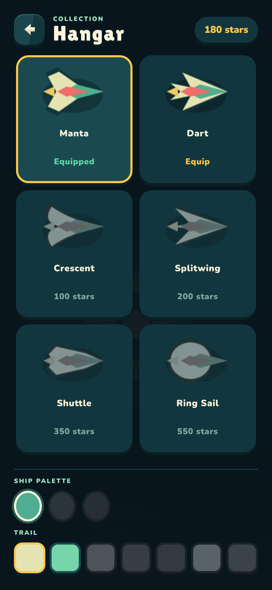

# Orbit Shift: Hangar remake and the next retention round

Proposal, 2026-10-19. Awaiting the owner's approval. Mockups:
- `design/paper-night/previews/hangar-directions.png`
- `design/paper-night/previews/retention-wave2.png`

The mockup source is `design/paper-night/mockups/hangar-retention.html`. All ship, trail and planet art in the mockups is exported from the game's own renderers (`export-hangar-assets.cjs`). Nothing is redrawn.

## 1. What's wrong with the Hangar today

Today the Hangar is three generic lists stacked on top of each other: planes, palette dots and trail squares. Every rule in the playbook says this shouldn't feel like a settings screen.
- **No showcase.** The equipped plane is a small card, so a purchase has nowhere to land.
- **Paints and trails are unnamed coloured squares.** "Pollen", "Spark" and "Crown gems" only exist in code.
- **Locked items give no reason to want them.** They're grey, with a tooltip on hover (phones don't hover), and there's no way to preview them.
- **It doesn't fit.** The whole screen scrolls at 390×844 and badly at 320×568.
- **It isn't in the story.** It's a generic "Collection" screen in a game about a moth who delivers mail.

## 2. Research: what strong games do, and what players complain about

Web sources on these exact systems were thin, so a few points below are well-known genre patterns rather than cited studies. Those are marked *(pattern)*.

| Pattern | Who does it | What we take |
|---|---|---|
| **A stage for the selected item.** The character or ship is shown big, and the world reacts to the choice. | Crossy Road: picking a character changes the world around it ([Wikipedia](https://en.wikipedia.org/wiki/Crossy_Road)). Sky: Children of the Light: you change outfits at spots in the home village. | A showcase that previews the plane, paint and trail together, live. |
| **Preview before you commit.** | Sky players built their own outfit-preview tools because the game lacked one ([Steam discussion](https://steamcommunity.com/app/2325290/discussions/0/4364628251568565441)). Store-preview bugs (Fall Guys, Marvel's Avengers) are among the angriest cosmetic complaints ([mp1st](https://mp1st.com/news/marvels-avengers-game-skin-locking-missing-issue-being-looked-into-heres-a-potential-workaround)). | Tapping **anything**, locked included, previews it. Previewing never spends, and Buy is a separate deliberate tap. |
| **Silhouettes plus "how to get it".** *(pattern)* | Pokédex-style collections. Alto's Adventure ties unlocks to 195+ goals ([App Store](https://apps.apple.com/app/id1576663233)). | A locked trail or paint shows its silhouette. The button names the condition and shows progress. |
| **Reward moments are staged.** | Our own PERFECT stamp, and the results beats. | The NEW postmark: the plane unfolds, the stamp lands, then Equip. |
| **Streak freezes and forgiving streaks.** | Duolingo: decoupling the streak from the daily goal raised D14 retention by 3.3%, and its Streak Wager raised D7 by 14%. Its Weekend Amulet lets people take breaks ([Duolingo blog](https://blog.duolingo.com/improving-the-streak), [making.duolingo](https://making.duolingo.com/how-streaks-keep-duolingo-learners-committed-to-their-language-goals)). | A Paper Moon freeze, and lanterns that **dim** instead of resetting, with a relight. |
| **Collection albums drive completion.** | Monopoly Go albums. Critics flag deadlines, duplicates and trading pressure as dark patterns ([Tech Insider](https://tech-insider.org/monopoly-go-sticker-economy-mobile-monetization/)). | A Stamp Album with **no expiry, no duplicates, no packs**. Every stamp comes from a known action. |
| **Return-to-check gifts and letters.** | Neko Atsume's visitors leave gifts while you're away ([Harvard Crimson](https://api.thecrimson.com/article/2016/2/2/neko-atsume)). Animal Crossing villagers write you letters ([Nookipedia](https://nookipedia.com/wiki/Letter)). Neko Atsume's weakness is that nothing is left once you've collected everything ([Daily Collegian](https://dailycollegian.com/2016/01/neko-atsume-app-offers-fun-feline-diversion)). | Islander postcards as the reward wrapper and a lore drip. New islands add new pages, so the collection keeps growing. |

## 3. Hangar design: A · The Sorting Room (recommended)

**Story:** the Hangar is Pip's sorting loft. Each glider is a folded letter waiting in its pigeonhole.

**Layout, top to bottom (fits 390×844 without scrolling):**
1. **Header:** folded back arrow, "Hangar", star chip.
2. **Showcase:**
   - A night window with stars and the moon.
   - The previewed plane bobbing on a folded paper stand, flying its current trail.
   - A paper name tag hanging on a string.
   - Paint previews tint the plane itself (Bloom / Ember / Void).
3. **Folder tabs: Planes · Paint · Trails.** Only one shelf is open at a time. The open tab is paper-coloured and joins the rack like a file folder.
4. **Sorting rack:**
   - 3×2 slots for planes.
   - 4 per row for trails, and for paints, each drawn as a folded paper swatch in its palette.
5. **One big button,** which changes with the previewed item:
   - Gold **BUY ★100** when you can afford it.
   - Mint **EQUIP** when you own it.
   - Quiet **Equipped** when it's already on.
   - A night button **"Finish 5 goals"** with a progress bar when it's locked.
   - "Need 20 more ★" with a bar when you can't afford it yet.

**States, readable without text:**
- Equipped: a gold wax seal with a tick, plus a gold edge.
- Previewed: a mint outline and the slot lifts 3 px.
- Affordable: a gold price tag.
- Too expensive: a muted price tag and the plane shown in muted colour.
- Locked by an achievement: a silhouette and a small lock.

**Names (for the hint lines and the tag):**
- Trails: Paper diamonds · Pollen · Spark · Ribbon · Echo rings · Crown gems · Petal wake. These follow `trailWords`.
- Paints: Bloom · Ember · Void.

**Buying:**
1. Stars fly from the chip into the slot.
2. The plane unfolds out of a dashed crease.
3. A gold **NEW** postmark stamps down (the same family as PERFECT), with paper confetti and a chime.
4. A single **EQUIP** button.

Saves happen before the animation, as the rewards already do.

**At 320×568:** the showcase shrinks to about 170 px, the rack becomes a 3×2 grid of smaller slots, and the button height drops to 56. It is still one screen.

**Fixed rules:** ship art (`drawGlider`), trail art (`drawTrailPiece`), prices and unlock rules all stay as they are. Only presentation changes. The DOM ids `riderGrid`, `cosmetics`, `trails` and `garageStars` are kept.

**B · Island Dock** (alternative): one plane at a time on a floating island, with arrows or swipe, dots and pill tabs. It's simpler and bigger, but you can't compare items or see at a glance what's left to earn. That is a weaker pull for a collection.

## 4. Retention, next round

Everything is told through the Night Post, and Home gets no new text.

### 4.1 Night 7: the parcel
- The 7th lantern on the string is already a parcel. On a 7-night streak it **glows and sways**. Pip holds the parcel, and a gold ring surrounds him.
- Tap Pip and the parcel opens in a short sequence: string unties, flaps fold open, light comes out.
- Then three fixed gifts:
  - **+25 stars**
  - **A week stamp** for the album
  - **A Paper Moon,** if you don't already hold one
- Every 4th parcel (night 28) also brings a trail. That needs new trail art, so it's for the owner to approve.
- It's the same every week: **no lottery, no "maybe"**.

### 4.2 Paper Moon: the streak freeze
- You hold at most **1 Paper Moon**. It comes in the weekly parcel, so a 7-night streak always refills it.
- **Missed one night with a Moon:** the Moon hangs in the missed slot on the string, smiling, and the streak continues. Pip does a little "phew" look.
- **Missed with no Moon:** the lanterns **dim** instead of disappearing. Fly tonight's run within the next night to **relight** them (an earn-back). Only after that does the string reset.
- **No punishment text, ever.** The only signal is lanterns going dim.

### 4.3 Islander postcards
- Level clears, parcels and chapter moments arrive as **postcards** from the islanders you helped:
  - Petal-folk on Bloom
  - Match-folk on Ember
  - Lost letters on Void
- The front is an illustration of the island at night. The back is one handwritten line, a stamp and a postmark.
- They are stored in the Mailbag under **Postcards**, with a strip showing how many there are per island.
- This is the story beat the bible asks for: wordless, under 5 seconds, and optional to read.
- **Content needed:** one line per level (12 for Bloom + Ember now), written cozy and funny. I'll draft them for approval.

### 4.4 The Stamp Album
- **Mailbag → Album:** one page per island. You switch islands with small round planet tabs.
- **Rows:**
  - Islands: one stamp per level, plus the gatekeeper.
  - Gold postmarks: 3★ on each level.
  - Specials: 10 and 25 lost letters, week parcels, Night 7 and other Tonight's Letter milestones.
- **Empty slots** show a faint picture of what goes there, plus a caption saying how to earn it.
- **A full page** gives a permanent reward (a new trail, art to be approved). The page shows a progress bar toward it.
- **No expiry, no duplicates, no paid packs.**

### 4.5 Where it all lives
- **Pip remains the one entry point** (the owner's earlier rule): tap Pip to open the Mailbag.
- The Mailbag gets three tabs: **Tonight · Postcards · Album**.
- A badge on the tab shows what's new.
- Home gains nothing except the lantern states.

## 5. Data and save (for the build)

New save fields, with a bump to `SAVE_VERSION = 6` and a migration from 5:
- `moons` (0–1)
- `parcels` (weeks claimed)
- `postcards` (ids received and read)
- `stamps` (ids)
- `lanternDim` (night it dimmed)

Old saves are backfilled with the stamps for levels already cleared and the 3★ stamps they've already earned.

All of this sits behind a flag until the owner has played it, like the other new mechanics.

## 6. Decisions for the owner

1. Hangar direction: **A · Sorting Room** (recommended) or B · Island Dock?
2. Lanterns: dim and relight instead of reset, with 1 Paper Moon held at most. OK?
3. Weekly parcel: 25★ + a stamp + a Moon. Should every 4th parcel add a trail (new art)?
4. Postcards: should I draft the 12 islander lines for your approval?
5. Album page reward: a new "pressed-petal" trail for Bloom (new art)?
